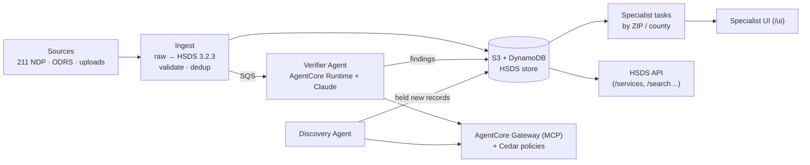

# BEVIJEN — The Resource Engine

**A community-resource database that keeps itself up to date.**

One Degree and 211 directories list 30,000+ local services (food, shelter, health care, legal aid…). Listings go stale the day they're published, and specialists keep them accurate by researching and calling each organization by hand. The Resource Engine:

1. **Ingests** data from several sources (211 NDP, One Degree ODRS, spreadsheets, already-HSDS records) and archives the raw bytes.
2. **Converts** everything to the Open Referral **HSDS v3.2.3** standard, validates it against the official schema, and deduplicates it.
3. **Verifies** records with AI agents on **Amazon Bedrock AgentCore** that check each record against the organization's website and write *findings* with evidence. The agents never silently change a record.
4. **Routes** whatever still needs a person to specialists as tasks grouped by ZIP code, so staff only work on records that need attention.
5. **Discovers** facilities that aren't in the database yet. New records stay held until an independent verifier pass.

## Live links

| | URL |
|---|---|
| Pitch deck | https://52-41-36-135.sslip.io/pitch-deck/ |
| Specialist UI (frontend) | https://52-41-36-135.sslip.io/ui/ |
| Backend API docs | https://52-41-36-135.sslip.io/docs |

All three are served by the same FastAPI server on one EC2 instance behind Caddy (HTTPS).

## Architecture



| Pipeline | What it does | Code |
|---|---|---|
| **A. Data processing** | fetch → archive raw → map to HSDS → normalise → validate (invalid → quarantine) → dedup → commit → pre-flag → queue for the verifier | `backend/app/pipeline.py`, `app/hsds/`, `app/store/` |
| **B. Specialist tasks** | open findings → one task per facility → ZIP/county buckets → claim, call, resolve | `backend/app/tasks/` |
| **C. Discovery** | agent finds new facilities → held records → independent check → published | `backend/app/discovery/` |

Core rules: one write path (`store/commit.py`), every change validated against the pinned HSDS schema, nothing invalid is stored or served, and AI output only becomes a record change after a person approves it.

### AWS services (region us-west-2)

| Area | Services | Used for |
|---|---|---|
| Compute | **Amazon EC2**, **AWS Systems Manager** (SSM), **Amazon ECR**, **AWS Lambda** | API server + worker (Docker Compose), remote ops, server and agent images, Gateway tool targets (`re-web-tools`) |
| Storage | **Amazon S3**, **Amazon S3 Vectors**, **Amazon DynamoDB** | raw pages, HSDS documents, quarantine, evidence, exports · knowledge-base vectors · HSDS store, index, findings, tasks, runs, API keys |
| Messaging and scheduling | **Amazon SQS** (+ DLQs), **Amazon EventBridge Scheduler**, **Amazon SNS** | verify and job queues · crawl every 15 min, nightly recheck, weekly discovery, daily NDP pull · alarm notifications |
| AI | **Amazon Bedrock** (Claude, Titan Text Embeddings v2) | agent reasoning, free-text schedule parsing, semantic search |
| Agents | **Amazon Bedrock AgentCore**: Runtime, Gateway (MCP), Policy (Cedar), Identity, Memory, Browser, Web Search, Observability | hosts the Verifier and Discovery agents, their tools, permissions, per-organization notes and traces |
| Search | **Amazon OpenSearch Service** (optional) | keyword + semantic search index |
| Document and language | **Amazon Textract**, **Amazon Translate**, **Amazon Comprehend** | PDF text extraction · translation · language detection |
| Location | **Amazon Location Service** (Places) | geocoding, reverse geocoding for ZIP buckets, places near a ZIP |
| Notifications | **Amazon SES**, **AWS End User Messaging SMS** | email and SMS from the agent `send_message` tool |
| Identity and security | **Amazon Cognito**, **AWS IAM**, **AWS STS**, **AWS Secrets Manager**, **AWS KMS** | specialist login + M2M tokens · least-privilege roles · ODRS key, tools key, API-key pepper · one CMK encrypting all data |
| Observability | **Amazon CloudWatch** (logs, metrics, alarms, Transaction Search), **AWS X-Ray** | run metrics, DLQ / quarantine alarms, agent spans and tool-call traces |
| Infrastructure as code | **Terraform**, **AWS CLI** (`infra/deploy.sh`) | Terraform: KMS, S3, DynamoDB, SQS, IAM · `deploy.sh`: everything else |

Full diagrams: [`docs/ARCHITECTURE.md`](docs/ARCHITECTURE.md).

## Repository layout

```
backend/        FastAPI server, pipelines, agents, AWS infra       → backend/README.md
  app/            server: pipelines, HSDS store, API routers, workers
  agents/         Verifier + Discovery agents (Strands, AgentCore Runtime)
  gateway/        AgentCore Gateway targets + Cedar policies
  lambdas/        Gateway Lambda targets (web tools)
  ingestion/      raw NDP / ODRS acquisition package                → backend/ingestion/README.md
  transform/      any-format → HSDS v3.2.3 converter (pinned schema) → backend/transform/README.md
  infra/          deploy.sh (AWS CLI), Terraform, IAM, table specs
  tests/          pytest suite (no AWS needed)
frontend/       React + Vite specialist UI, served at /ui            → frontend/frontend.md
pitch-deck/     single-page pitch deck, served at /pitch-deck/
ai/             AI design: agents, tools, Gateway, policies         → ai/ai.md
docs/           architecture, system design, HSDS reference, One Degree background
```

## Quick start (local, no AWS)

**Backend**

```bash
cd backend
python3.12 -m venv .venv && source .venv/bin/activate
pip install -r requirements-dev.txt
pytest

STORE_BACKEND=memory AUTH_MODE=dev AGENT_MODE=off RUN_WORKERS=true uvicorn app.main:app --reload
curl -F file=@ingestion/tests/fixtures/national-data-platform-sample-1.json http://127.0.0.1:8000/ingest/ndp/upload
open http://127.0.0.1:8000/docs
```

**Frontend**

```bash
cd frontend
npm install
printf 'VITE_BACKEND_URL=http://127.0.0.1:8000\nVITE_AUTH_MODE=dev\n' > .env.local   # omit to use the deployed backend
npm run dev        # http://localhost:5173
npm test
```

In `AUTH_MODE=dev`, `X-Dev-User` / `X-Dev-Groups` headers stand in for Cognito. Use it only on a laptop.

**Converter only** (standard library, no install):

```bash
cd backend/transform
python3 -m hsds_transform convert ../ingestion/tests/fixtures/national-data-platform-sample-1.json -o work/ndp --source ndp
```

## Deploy (AWS, us-west-2)

```bash
cd backend
export AWS_REGION=us-west-2 RE_PUBLIC_URL=https://<host> SG_ID=sg-… SUBNET_ID=subnet-…
./infra/deploy.sh all
```

`deploy.sh server` builds the frontend and pitch deck into the server image. Terraform (`backend/infra/terraform/`) owns KMS, S3, DynamoDB, SQS and IAM. `deploy.sh` handles the rest. See [`backend/backend.md` §8](backend/backend.md) for each step.

## Documentation

| Document | Contents |
|---|---|
| [`backend/backend.md`](backend/backend.md) | Server, data model, pipelines, full HTTP API, config, tests |
| [`ai/ai.md`](ai/ai.md) | Where AI is used, agents, tools, Gateway, Cedar policies |
| [`docs/ARCHITECTURE.md`](docs/ARCHITECTURE.md) | AWS service map, ingest and verification flows |
| [`docs/BACKEND-FOR-FRONTEND.md`](docs/BACKEND-FOR-FRONTEND.md) | API reference for frontend developers |
| [`docs/SystemDesign/`](docs/SystemDesign/) | Design spec (`RESOURCE-ENGINE-DESIGN.md`), agent contract (`AGENT.md`), verification procedure (`SKILL.md`) |
| [`docs/IMPLEMENTATION-NOTES.md`](docs/IMPLEMENTATION-NOTES.md) | What was built, design deviations, open items |
| [`docs/hsds/`](docs/hsds/README.md) | HSDS v3.2.3 reference: every object, relationships, conversion guide |
| [`docs/agentcore-demo.md`](docs/agentcore-demo.md) | AgentCore Verifier demo with CloudWatch evidence |
| [`docs/one-degree/`](docs/one-degree/) | One Degree vision and technical background |
| [`backend/docs/HSDS-INTAKE-HANDOFF.md`](backend/docs/HSDS-INTAKE-HANDOFF.md) | Intake contract for already-HSDS records |
| [`frontend/frontend.md`](frontend/frontend.md) | UI run, sign-in flow, screens |

## Status

The deployed stack runs NDP ingestion, HSDS storage, the API, the Verifier on AgentCore, and the specialist review UI. Open items include the verifier evaluation set, live NDP API access (the contract is still provisional), incremental search indexing and a move to ECS Fargate. The full list is in [`docs/IMPLEMENTATION-NOTES.md` §4](docs/IMPLEMENTATION-NOTES.md).
