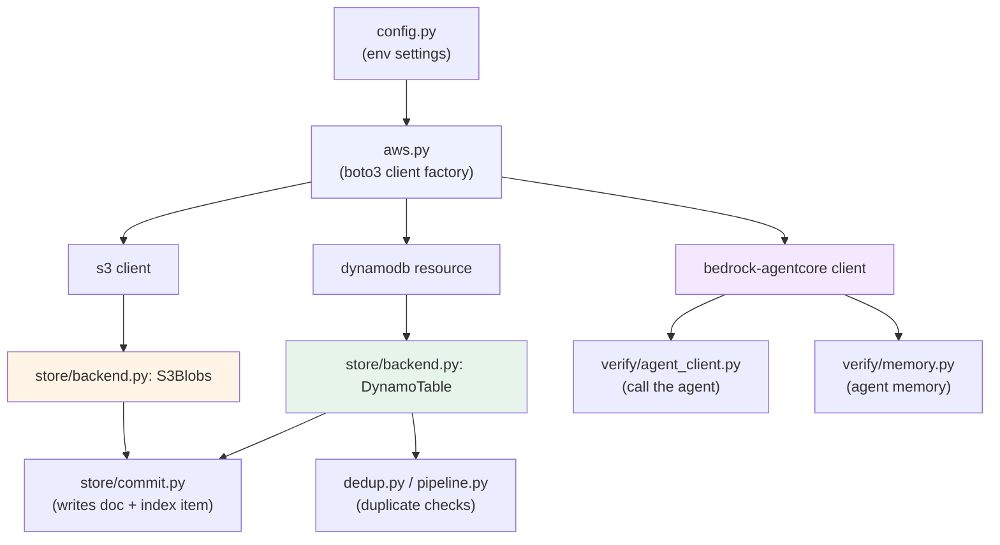
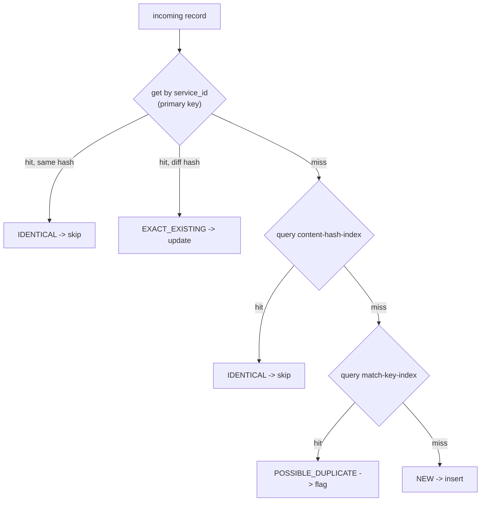
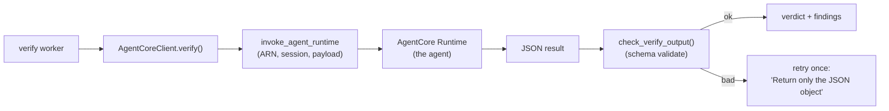
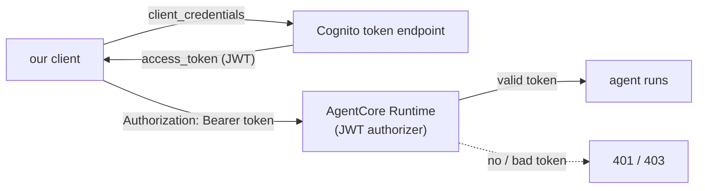

# AWS Services - Code Walkthrough (How We Actually Did It)

This is the "show me the code" companion to
`AWS-SERVICES-EXPLAINED-FROM-OUR-PROJECT.md`. For each AWS service it gives:

- a **diagram** of how it fits,
- the **real code** from our repo (file + what it does),
- a **short explanation** next to each snippet,
- a **detailed explanation** for depth,
- **interview Q&A** you can rehearse.

> All code below is quoted from the `main` branch. File paths are relative to
> `backend/`.

---

## Table of contents
1. The shape of it all (one diagram)
2. boto3 client factory - `app/aws.py`
3. Amazon S3 - `app/store/backend.py` (`S3Blobs`)
4. Amazon DynamoDB - `app/store/backend.py` (`DynamoTable`, `SPECS`)
5. How a record is written to both - `app/store/commit.py`
6. Dedup against DynamoDB - `app/dedup.py` + `app/pipeline.py`
7. Amazon Bedrock (the model) - `config.py` + verify worker
8. Bedrock AgentCore (agents) - `app/verify/agent_client.py`
9. AgentCore Memory - `app/verify/memory.py`
10. AgentCore inbound OAuth (JWT) - `app/verify/agent_client.py`
11. Config that wires it all - `app/config.py`
12. Interview cheat-sheet (rapid fire)

---

## 1. The shape of it all



**One-line takeaway:** `config.py` holds settings → `aws.py` builds every AWS
client from them → everything else (`store`, `dedup`, `verify`) uses those
clients. One factory, one config, no scattered credentials.

---

## 2. boto3 client factory - `app/aws.py`

### Short explanation
Every AWS call in the app goes through one tiny module. It builds boto3 clients
with retries configured, caches them, and (for tests) can point at LocalStack.
Nothing reads hard-coded keys - credentials come from the standard AWS chain.

### The code
```python
# app/aws.py
_CFG = Config(retries={"total_max_attempts": 4, "mode": "adaptive"})

# Agent runs are long (2-20 min); a short timeout caused retries that started
# NEW paid runs. So: long read timeout, no retries.
_AGENT_CFG = Config(read_timeout=1500, retries={"total_max_attempts": 1})

_LOCAL_OK = {"s3", "dynamodb", "sqs", "secretsmanager", "cloudwatch", "kms"}

@lru_cache(maxsize=None)
def _client(service: str, region: str, endpoint: str) -> Any:
    kwargs = {"region_name": region,
              "config": _AGENT_CFG if service == "bedrock-agentcore" else _CFG}
    if endpoint and service in _LOCAL_OK:        # LocalStack only for emulable services
        kwargs["endpoint_url"] = endpoint
    return boto3.client(service, **kwargs)

def client(service: str, settings=None):
    s = settings or get_settings()
    return _client(service, s.aws_region, s.aws_endpoint_url)
```

### Detailed explanation
- **`@lru_cache`** means each `(service, region, endpoint)` client is built once
  and reused - boto3 clients are thread-safe and expensive to create, so caching
  matters.
- **Two Config objects**: normal AWS calls retry 4x with adaptive backoff; the
  `bedrock-agentcore` client uses a 25-minute read timeout and **no retries**,
  because a retry would launch a second paid agent run. This is a real-money
  lesson baked into config.
- **`_LOCAL_OK`** lets S3/DynamoDB/SQS point at LocalStack in dev while Bedrock
  always talks to real AWS (you can't emulate the models).
- **Credentials**: never in code. boto3 pulls them from the environment /
  instance role / SSO - the "standard credential chain."

### Interview Q&A
- *Q: Why centralize client creation?* One place for region, retries, timeouts,
  and test endpoints; clients are cached and reused; no duplicated config.
- *Q: Why no retries on the agent client?* The call is long-running and billed
  per run; a botocore retry would start a second run. SQS redelivery is the real
  retry mechanism.
- *Q: Where do credentials come from?* The default AWS credential chain (env,
  instance profile, SSO) - never static keys in code.

---

## 3. Amazon S3 - `app/store/backend.py` (`S3Blobs`)

### Short explanation
`S3Blobs` is a thin wrapper that stores/reads JSON documents in our bucket, with
encryption on by default. Each record's full HSDS document is one S3 object.

### The code
```python
# app/store/backend.py
class S3Blobs:
    def __init__(self, bucket: str, s3_client, kms_key_id: str = ""):
        self.bucket = bucket
        self._s3 = s3_client
        # KMS if a key is configured, else S3-managed encryption (AES256)
        self._sse = ({"ServerSideEncryption": "aws:kms", "SSEKMSKeyId": kms_key_id}
                     if kms_key_id else {"ServerSideEncryption": "AES256"})

    def put_json(self, key, value):
        body = json.dumps(value, separators=(",", ":"), default=str).encode()
        return self.put_bytes(key, body, "application/json")

    def put_bytes(self, key, body, content_type="application/octet-stream"):
        resp = self._s3.put_object(Bucket=self.bucket, Key=key, Body=body,
                                   ContentType=content_type, **self._sse)
        return resp.get("VersionId")

    def get_json(self, key):
        body = self.get_bytes(key)
        return json.loads(body) if body is not None else None
```

### Detailed explanation
- **Encryption is always on** - KMS if `kms_key_id` is set, otherwise AES256
  (SSE-S3). Security by default, no caller has to remember it.
- **`put_json` returns a `VersionId`** - the bucket has versioning, so edits keep
  history (you can retrieve an older version of a record).
- **Interface, not boto3 everywhere** - domain code calls `blobs.put_json(...)`,
  never `boto3` directly. That is why tests can swap in `MemoryBlobs` (a dict).

### Interview Q&A
- *Q: Why store full documents in S3 and not DynamoDB?* S3 is cheap, size-
  unlimited object storage; the nested HSDS graph can be large. DynamoDB has a
  400 KB item cap and is meant for fast key lookups, not big blobs.
- *Q: How is data encrypted?* Server-side: KMS when a key is configured, else
  SSE-S3 (AES256). Set in one place (`_sse`).

---

## 4. Amazon DynamoDB - `app/store/backend.py` (`DynamoTable`, `SPECS`)

### Short explanation
One `TableSpec` describes each table (its key + indexes) once, and the same spec
drives the real DynamoDB table, the in-memory test fake, and the infra
create-table JSON. `DynamoTable` wraps get/put/query/scan.

### The code - table + index definitions
```python
# app/store/backend.py
SPECS = {
    # one item per service - the dedup + status "index card"
    "index": TableSpec("index", "service_id", None, (
        Index("content-hash-index", "hash_pk"),            # find identical content
        Index("match-key-index",   "match_pk"),            # find possible duplicate
        Index("status-index",      "status_pk", "last_seen_at"),  # list by status
    )),
    "hsds": TableSpec("hsds", "PK", "SK", (
        Index("org-index",  "org_pk", "entity_sk"),
        Index("zip-index",  "zip_pk", "PK"),
        Index("type-index", "entity_type", "PK"),
    )),
    # ... findings, tasks, runs, keys ...
}
```

### The code - query is indexed, never a full scan
```python
# app/store/backend.py  (DynamoTable.query)
def query(self, hash_value, *, index=None, prefix=None, limit=None, descending=False):
    hk, rk = (ix.hash_key, ix.range_key) if index else (self.spec.hash_key, self.spec.range_key)
    cond = Key(hk).eq(hash_value)
    if prefix is not None and rk:
        cond = cond & Key(rk).begins_with(prefix)
    kwargs = {"KeyConditionExpression": cond, "ScanIndexForward": not descending}
    if index:
        kwargs["IndexName"] = index
    # ... paginates and returns items ...
```

### Detailed explanation
- **GSI = Global Secondary Index.** The `index` table's primary key is
  `service_id`, but we also need "find by content hash" and "find by match key."
  Each GSI has its own partition key (`hash_pk`, `match_pk`) so those become
  direct lookups.
- **One spec, three uses:** `TableSpec` also has `create_table_json()` which
  generates the CloudFormation-style create-table definition - so the code and
  the infra never drift apart.
- **Query vs Scan:** `query()` uses `KeyConditionExpression` (jumps to matching
  keys). There is a `scan()` too, but the dedup path never calls it - that's what
  keeps dedup O(1)-ish regardless of table size.

### Interview Q&A
- *Q: What is a GSI and why use one?* A secondary index that lets you query by a
  non-primary attribute. We use them so "is this a duplicate?" and "show
  unverified records" are indexed lookups, not scans.
- *Q: Query vs Scan?* Query targets specific keys (fast, cheap). Scan reads the
  whole table (slow, expensive). We only Query on hot paths.
- *Q: How do you avoid code/infra drift?* One `TableSpec` drives the live table,
  the test fake, and the create-table JSON.

---

## 5. Writing a record to BOTH stores - `app/store/commit.py`

### Short explanation
`commit()` is the single write path. It validates, writes the full document to
S3, and upserts the small index item in DynamoDB (with the dedup keys + status).

### The code (the dual write)
```python
# app/store/commit.py
def s3_key(source, service_id):
    return f"hsds/{source}/{service_id}.json"      # source is in the key -> categorization

# ... after validating each service document ...
for sid, doc in docs.items():
    key = s3_key(doc_source, sid)
    stores.blobs.put_json(key, doc)                # (1) full document -> S3
    existing = stores.index.get(sid) or {}
    item = {
        **existing,
        "service_id": sid,
        "source": existing.get("source", doc_source),
        "s3_key": key,                             # pointer back to S3
        "content_hash": content_hash(doc),         # dedup key
        "hash_pk": content_hash(doc),              # -> content-hash-index GSI
        "fuzzy_match_key": fuzzy_match_key(doc),   # dedup key
        "match_pk": fuzzy_match_key(doc),          # -> match-key-index GSI
        "verification_status": existing.get("verification_status", "unverified"),
        # ...
    }
    item["status_pk"] = item["verification_status"]  # -> status-index GSI
    stores.index.put(item)                           # (2) index card -> DynamoDB
```

### Detailed explanation
- **The S3 key encodes the source** (`hsds/{source}/{id}.json`), which is how we
  categorize records by origin (odrs / ndp) without opening files.
- **The index item duplicates just the searchable bits** (hashes, match key,
  status) plus `s3_key` to find the document. The `*_pk` fields are what the GSIs
  index on.
- **Idempotent upsert:** `{**existing, ...}` preserves fields already set
  (e.g. a human's verified status) while updating the rest.

### Interview Q&A
- *Q: Why write to two places?* S3 = durable full document; DynamoDB = fast
  searchable index + status. The index item points back to S3 via `s3_key`.
- *Q: How is re-ingestion safe?* The item is an upsert keyed by the deterministic
  `service_id`, and existing fields are merged, so re-running updates rather than
  duplicating.

---

## 6. Dedup against DynamoDB - `app/dedup.py` + `app/pipeline.py`

### Short explanation
For each incoming record we do at most 3 indexed lookups: by ID, by content
hash, by match key. First hit wins. No scanning.

### Diagram


### The code - the lookups (pipeline.py)
```python
# app/pipeline.py
class IndexLookup:
    def __init__(self, ctx): self.t = ctx.stores.index
    def get_index_item(self, service_id):
        return self.t.get(service_id)                                  # primary key GET
    def find_by_content_hash(self, h):
        rows = self.t.query(h, index="content-hash-index", limit=1)    # GSI query
        return rows[0] if rows else None
    def find_by_match_key(self, k):
        rows = self.t.query(k, index="match-key-index", limit=2) if k else []
        return rows[0] if rows else None
```

### The code - the decision (dedup.py)
```python
# app/dedup.py
def classify(lookup, *, service_id, content_hash, match_key):
    existing = lookup.get_index_item(service_id)
    if existing is not None:
        if existing.get("content_hash") == content_hash:
            return DupDecision(DupKind.IDENTICAL_PAYLOAD, existing)    # unchanged
        return DupDecision(DupKind.EXACT_EXISTING, existing)          # changed -> update
    same = lookup.find_by_content_hash(content_hash)
    if same is not None:
        return DupDecision(DupKind.IDENTICAL_PAYLOAD, same)
    if match_key:
        m = lookup.find_by_match_key(match_key)
        if m is not None and m.get("service_id") != service_id:
            return DupDecision(DupKind.POSSIBLE_DUPLICATE, m)         # flag for human
    return DupDecision(DupKind.NEW)
```

### Detailed explanation
- The hashes/keys are **precomputed at write time** and stored as GSI partition
  keys, so each check is a direct indexed lookup.
- The function **short-circuits**: as soon as one lookup matches, it returns, so
  the common "exact re-ingest" case is a single GetItem.
- Fuzzy matching is intentionally **exact-equality on a normalized key** - fast
  and conservative; it only flags, never auto-merges.

### Interview Q&A
- *Q: Does adding a record scan the whole DB?* No - up to 3 indexed lookups,
  constant-time regardless of table size.
- *Q: How do you detect the same real-world org from two sources?* A normalized
  "match key" (org name + ZIP/phone) stored on a GSI; a collision flags
  `possible_duplicate` for human review.

---

## 7. Amazon Bedrock (the model) - `config.py` + verify worker

### Short explanation
The model id is a single setting. The verification agent uses that model to read
web content and judge a record; we record which model made each decision.

### The code
```python
# app/config.py
bedrock_model_id: str = field(default_factory=lambda:
    _env("BEDROCK_MODEL_ID", "us.anthropic.claude-sonnet-4-5-20250929-v1:0"))
```
```python
# app/verify/worker.py
item["last_check_model"] = out.get("model_id") or ctx.settings.bedrock_model_id
```

### Detailed explanation
- **Model as config** - swapping Claude versions is an env var, not a code change.
- **Provenance** - every verification result records `last_check_model`, so you
  can audit which model produced a finding (important when models change).
- The actual model call happens inside the agent (next section) via AgentCore;
  the server records the model id with the result.

### Interview Q&A
- *Q: How do you pick/switch models?* A single `BEDROCK_MODEL_ID` setting; the
  default is a Claude Sonnet model. No code change to switch.
- *Q: Why record the model id per result?* Auditability - findings are only
  trustworthy if you know which model (and version) produced them.

---

## 8. Bedrock AgentCore (agents) - `app/verify/agent_client.py`

### Short explanation
Our verification/discovery agents run on AgentCore Runtime. The client calls
`invoke_agent_runtime`, reads the streamed response, and validates the JSON
against a fixed schema (with one retry).

### Diagram


### The code
```python
# app/verify/agent_client.py
class AgentCoreClient:
    mode = "agentcore"
    def __init__(self, settings):
        from .. import aws
        self.settings = settings
        self._c = aws.client("bedrock-agentcore", settings)   # the AgentCore client

    def _invoke(self, arn, payload, session_id):
        resp = self._c.invoke_agent_runtime(
            agentRuntimeArn=arn, runtimeSessionId=session_id,
            payload=json.dumps(payload).encode(),
            contentType="application/json", accept="application/json")
        body = resp.get("response")
        raw = body.read() if hasattr(body, "read") else b"".join(body)
        return parse_json_text(raw.decode("utf-8", "replace"))

    def verify(self, payload):
        sid = payload["service_id"]
        session = self._session("verify")   # fresh session each check
        try:
            return check_verify_output(self._invoke(self.settings.verifier_agent_arn, payload, session), sid)
        except (AgentOutputError, ValueError):
            retry = {**payload, "instruction": "Return only the JSON object."}
            return check_verify_output(self._invoke(self.settings.verifier_agent_arn, retry, session), sid)
```

### Detailed explanation
- **`invoke_agent_runtime`** is the AgentCore Runtime call; we pass the agent's
  **ARN**, a **session id**, and a JSON **payload**.
- **Response is streamed** - we read the body whether it's a stream or bytes.
- **Schema validation + one retry** - LLMs sometimes wrap JSON in prose; we try
  once more with "Return only the JSON object," then give up and mark
  `check_failed`. Robustness without infinite loops.
- **Pluggable modes** - `build_agent_client()` returns `AgentCoreClient`,
  `InProcessClient`, or `OffClient` based on `AGENT_MODE`, so the same worker runs
  against real AgentCore, local agent code, or no agent (tests).

### Interview Q&A
- *Q: What is an "agent" vs a plain model call?* An agent can call tools, keep
  memory, and runs as a managed service (AgentCore Runtime); a plain call just
  returns text.
- *Q: How do you handle messy LLM output?* Validate against a schema; retry once
  with a stricter instruction; else mark the check failed. No silent bad data.
- *Q: Why a fresh session per check?* So one record's context can't leak into
  another's result.

---

## 9. AgentCore Memory - `app/verify/memory.py`

### Short explanation
Agents remember per-organization notes ("confirmed by phone," "site blocks
bots"). With AgentCore Memory configured it uses that service; without it, it
falls back to a DynamoDB table - same interface either way.

### The code
```python
# app/verify/memory.py
def add(self, org_id, text, *, author):
    if self.settings.memory_id:                          # AgentCore Memory path
        self._client().batch_create_memory_records(
            memoryId=self.settings.memory_id,
            records=[{"requestIdentifier": uuid.uuid4().hex,
                      "namespaces": [f"org/{org_id}"],
                      "content": {"text": text},
                      "timestamp": datetime.now(timezone.utc),
                      "metadata": {"author": {"stringValue": author}}}])
        return
    # fallback: store the note as a row in the findings table
    self.stores.findings.put({"PK": f"ORG#{org_id}", "SK": f"NOTE#{now_iso()}...",
                              "text": text, "author": author})
```

### Detailed explanation
- **Namespaced by org** (`org/{id}`) so notes are scoped per organization.
- **Graceful fallback** - if Memory isn't configured or errors, notes go to the
  findings table. The caller doesn't care which path ran. This is the "replaceable
  component" pattern: swap the backend without touching callers.

### Interview Q&A
- *Q: Why does an agent need memory?* To carry context across runs (human notes,
  known site quirks) so later checks are smarter and don't re-flag resolved
  issues.
- *Q: What if the Memory service is down/unset?* The code falls back to a table
  transparently - no crash, no lost notes.

---

## 10. AgentCore inbound OAuth (JWT) - `app/verify/agent_client.py`

### Short explanation
One of our agent runtimes is protected by an inbound JWT authorizer. To call it
we fetch a Cognito machine-to-machine token and send it as a Bearer header
(SigV4 is refused by OAuth runtimes).

### Diagram


### The code
```python
# app/verify/agent_client.py
def _m2m_token(self):
    # Cognito client_credentials token (cached until ~60s before expiry)
    basic = base64.b64encode(f"{s.agent_m2m_client_id}:{aws.secret(s.agent_m2m_secret)}".encode()).decode()
    req = urllib.request.Request(
        f"https://{s.cognito_domain}/oauth2/token", method="POST",
        data=urllib.parse.urlencode({"grant_type": "client_credentials",
                                     "scope": "re-agents/invoke"}).encode(),
        headers={"Authorization": f"Basic {basic}",
                 "Content-Type": "application/x-www-form-urlencoded"})
    # ... parse access_token, cache with expiry ...

def _invoke_jwt(self, arn, payload, session_id):
    url = (f"https://bedrock-agentcore.{self.settings.aws_region}.amazonaws.com/runtimes/"
           f"{urllib.parse.quote(arn, safe='')}/invocations")
    req = urllib.request.Request(url, method="POST", data=json.dumps(payload).encode(), headers={
        "Authorization": f"Bearer {self._m2m_token()}",      # the inbound OAuth token
        "Content-Type": "application/json", "Accept": "application/json",
        "X-Amzn-Bedrock-AgentCore-Runtime-Session-Id": session_id})
```

### Detailed explanation
- **Two layers of auth exist** - this is the *inbound* one (caller -> runtime).
  The runtime has a JWT authorizer; a request with no/!valid token is rejected
  (401/403). That rejection is exactly the "inbound OAuth" challenge proof.
- **Client credentials grant** - machine-to-machine (no user); Cognito issues a
  JWT for the app client, scoped `re-agents/invoke`.
- **Bearer, not SigV4** - OAuth-protected runtimes refuse AWS SigV4 signing, so
  we build a raw HTTPS request with the Bearer header instead of using the SDK's
  signed `invoke_agent_runtime`.
- **The secret is read from Secrets Manager** (`aws.secret(...)`), never
  hard-coded, and the token is cached until just before expiry.

### Interview Q&A
- *Q: What are the OAuth layers in AgentCore?* Inbound (caller -> runtime, JWT),
  outbound (agent -> external API via credential provider), gateway (gateway ->
  upstream). They look alike (401/403) but have different causes.
- *Q: Why Bearer instead of the SDK call?* OAuth runtimes reject SigV4; you must
  send the JWT as a Bearer token over HTTPS.
- *Q: Where does the client secret live?* AWS Secrets Manager, fetched at runtime
  and cached; never in code or logs.

---

## 11. Config that wires it all - `app/config.py`

### Short explanation
Every AWS resource name, model id, and auth setting is an environment variable
with a sensible default. Nothing is hard-coded in logic.

### The code (the AWS bits)
```python
# app/config.py
aws_region:       str = _env("AWS_REGION", "us-west-2")
aws_endpoint_url: str = _env("RE_AWS_ENDPOINT_URL")                 # LocalStack
s3_bucket:        str = _env("RE_S3_BUCKET", "team20-s3-test-bucket")
ddb_index_table:  str = _env("RE_DDB_INDEX_TABLE", "team20-resource-engine-index")
kms_key_id:       str = _env("RE_KMS_KEY_ID")                       # empty -> SSE-S3
sqs_verify_url:   str = _env("RE_SQS_VERIFY_URL")
agent_mode:       str = _env("AGENT_MODE", "agentcore")            # agentcore|inprocess|off
verifier_agent_arn: str = _env("VERIFIER_AGENT_ARN")
bedrock_model_id: str = _env("BEDROCK_MODEL_ID", "us.anthropic.claude-sonnet-4-5-...")
cognito_client_id:  str = _env("COGNITO_CLIENT_ID")
memory_id:          str = _env("AGENTCORE_MEMORY_ID")
```

### Detailed explanation
- **12-factor style**: config comes from the environment, so the same image runs
  locally (LocalStack), in staging, and in prod by changing env vars only.
- **Safe defaults**: bucket/table names default to the team's real resources;
  model defaults to a Claude Sonnet; `agent_mode` defaults to real AgentCore but
  flips to `off` for tests.
- **Secrets are references, not values** (`agent_m2m_secret` is a Secrets Manager
  id, resolved by `aws.secret()`).

### Interview Q&A
- *Q: How is the app configured across environments?* Pure environment variables
  with defaults (12-factor); no per-environment code branches.
- *Q: How do you run tests without AWS?* Set `AGENT_MODE=off` and use the memory
  stores / LocalStack endpoint; the client factory and config make that a config
  change, not a code change.

---

## 12. Interview cheat-sheet (rapid fire)

| Question | One-line answer |
|----------|-----------------|
| Why S3 + DynamoDB? | S3 = cheap big documents; DynamoDB = fast indexed lookups + status. |
| What's a GSI? | A secondary index to query by a non-primary field (we use 3 on the index table). |
| How is dedup fast? | Precomputed hash + match key stored as GSI keys → up to 3 indexed lookups, no scan. |
| Query vs Scan? | Query jumps to keys (fast); Scan reads everything (slow). Dedup only queries. |
| How is re-ingest idempotent? | Deterministic `service_id` + merge-upsert of the index item. |
| Where do AWS clients come from? | One cached factory (`aws.py`); credentials from the standard chain. |
| How is data encrypted? | S3 server-side (KMS or AES256), set once in `S3Blobs`. |
| What is Bedrock here? | The Claude model (config id) the agent uses to judge records. |
| What is AgentCore? | Managed runtime that runs our agents, plus Memory and inbound auth. |
| Inbound OAuth proof? | Runtime has a JWT authorizer; call with no/!valid token → 401/403. |
| Why Bearer not SigV4 for the agent? | OAuth runtimes reject SigV4; send the Cognito JWT as Bearer. |
| Where are secrets? | AWS Secrets Manager via `aws.secret()`, cached, never logged. |
| How do you test without AWS? | `AGENT_MODE=off` + in-memory stores (fakes implement the same interface). |

---

### Files referenced (open these to go deeper)
```
backend/app/aws.py                 - boto3 client factory
backend/app/config.py              - all settings (env-driven)
backend/app/store/backend.py       - S3Blobs, DynamoTable, SPECS (tables + GSIs)
backend/app/store/__init__.py      - builds the Stores container
backend/app/store/commit.py        - the dual write (S3 + DynamoDB)
backend/app/dedup.py               - duplicate classification
backend/app/pipeline.py            - IndexLookup + how classify is used
backend/app/verify/agent_client.py - AgentCore invoke + inbound JWT
backend/app/verify/memory.py       - AgentCore Memory (+ table fallback)
```
