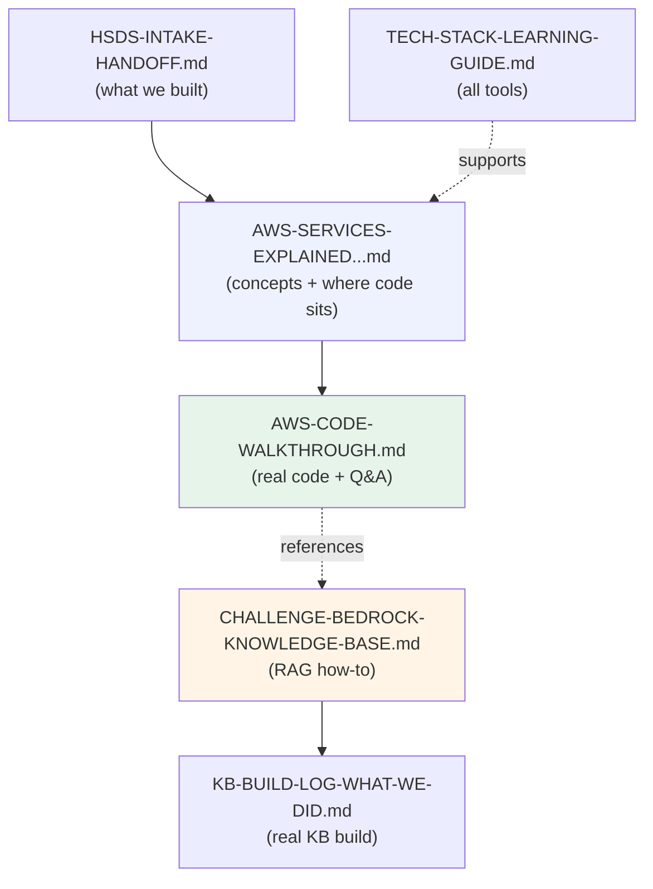

# Docs Index - Resource Engine (HSDS Intake + AWS)

A guide to the documents in this folder: what each one is, and which to read for
learning, for interviews, or for handoff.

---

## Read-by-goal

| Your goal | Start here |
|-----------|-----------|
| Understand what we built (for a teammate) | `HSDS-INTAKE-HANDOFF.md` |
| Learn the AWS services as a beginner | `AWS-SERVICES-EXPLAINED-FROM-OUR-PROJECT.md` |
| See the actual code behind each service | `AWS-CODE-WALKTHROUGH.md` |
| Learn every tool/library we used | `TECH-STACK-LEARNING-GUIDE.md` |
| Do the Bedrock Knowledge Base (RAG) challenge | `CHALLENGE-BEDROCK-KNOWLEDGE-BASE.md` |
| See what we actually built in AWS for the KB | `KB-BUILD-LOG-WHAT-WE-DID.md` |
| Understand the infrastructure (Terraform) | `TERRAFORM-EXPLAINED.md` |
| Prepare for an interview | the Q&A sections in `AWS-CODE-WALKTHROUGH.md` + `TERRAFORM-EXPLAINED.md` + soundbites in the learning guides |

---

## The documents

### 1. `HSDS-INTAKE-HANDOFF.md` - Team handoff
What the intake component does, the pipeline, the S3/DynamoDB data model, the AWS
resources, config, API, how to run/test, and known gaps. Written for a teammate
picking up the work.

### 2. `AWS-SERVICES-EXPLAINED-FROM-OUR-PROJECT.md` - Beginner AWS guide
Each AWS service (S3, DynamoDB, Bedrock, AgentCore, IAM, boto3) explained in
plain English + technical terms, with rendered diagrams, tied to where it lives
in our code. Ends with a 21-point one-liner summary.

### 3. `AWS-CODE-WALKTHROUGH.md` - Code walkthrough (how we did it)
The "show me the code" version. For every service: a diagram, the real code from
the repo, a short + detailed explanation, and interview Q&A. Best for going deep.

### 4. `TECH-STACK-LEARNING-GUIDE.md` - Tech stack learning guide
Every language, framework, library, standard, and practice (Python, FastAPI,
Pydantic, HSDS, REST, Git, Docker, etc.) in layman + technical terms, with
"interview soundbites."

### 5. `CHALLENGE-BEDROCK-KNOWLEDGE-BASE.md` - RAG / Knowledge Base how-to
A general, step-by-step guide to ingesting documents into a Bedrock Knowledge
Base and getting a cited answer (RAG). Diagrams, commands, common mistakes,
security notes, and an interview summary.

### 6. `KB-BUILD-LOG-WHAT-WE-DID.md` - Real KB build log
The actual run: resources created (bucket, vector store, IAM role, KB, data
source), what succeeded, the ingestion failure and its fix, current state,
remaining steps, and console URLs for screenshots.

### 7. `TERRAFORM-EXPLAINED.md` - Infrastructure as Code (Terraform)
Terraform from zero for a beginner: what it is, why we use it, and a file-by-file
walkthrough of our `infra/terraform/` (KMS, S3, DynamoDB, SQS, IAM, outputs) with
diagrams, real code, and interview Q&A.

---

## How the pieces relate

---

## Suggested reading order for a beginner

1. `AWS-SERVICES-EXPLAINED-FROM-OUR-PROJECT.md` - get the mental model.
2. `AWS-CODE-WALKTHROUGH.md` - see it in real code.
3. `TECH-STACK-LEARNING-GUIDE.md` - fill in the non-AWS tools.
4. `CHALLENGE-BEDROCK-KNOWLEDGE-BASE.md` + `KB-BUILD-LOG-WHAT-WE-DID.md` - the RAG topic.
5. `HSDS-INTAKE-HANDOFF.md` - the full feature in context.
