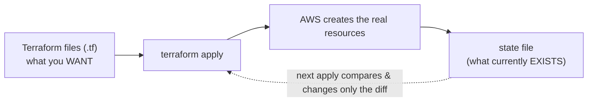
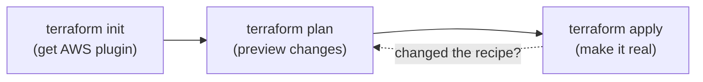
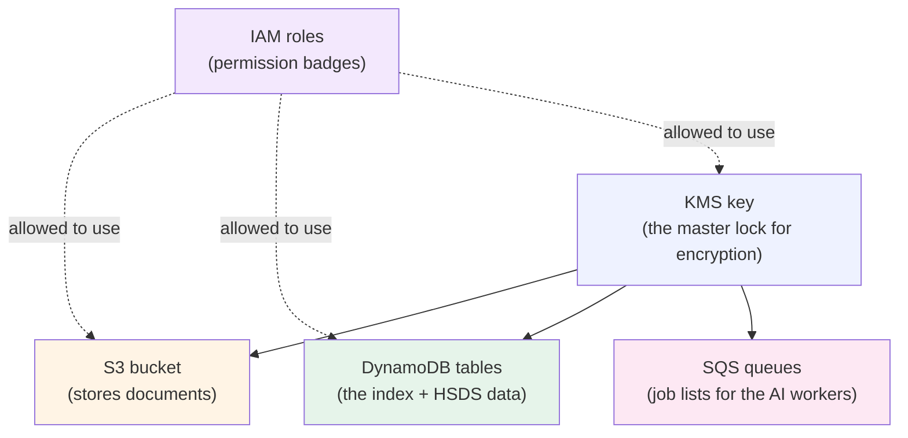
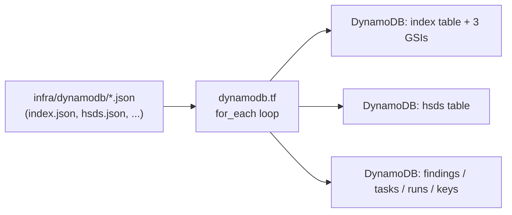
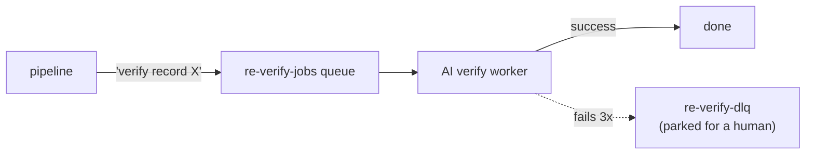
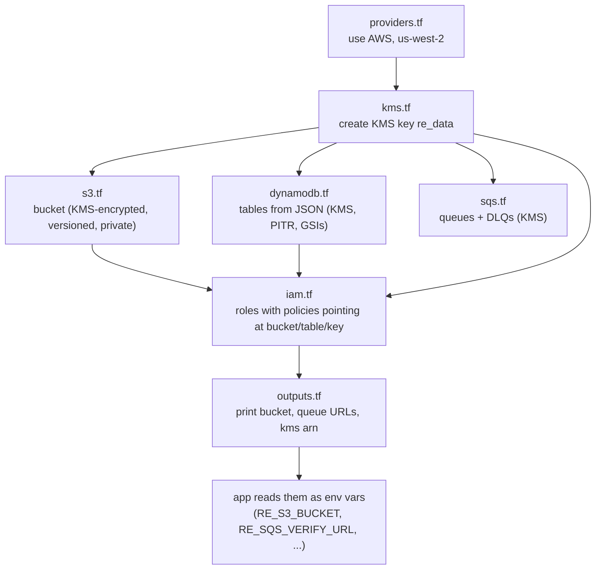

# Terraform (Infrastructure as Code) - Explained From Our Project

You said you don't know Terraform - this starts from zero. It explains what
Terraform is, why we use it, how it works, and then walks through **our actual
Terraform files** with diagrams, real code, short + detailed explanations, and
interview Q&A.

> Our Terraform lives in `backend/infra/terraform/`.

---

## 1. What is Terraform? (layman terms)

Normally, to create AWS things (an S3 bucket, a database, queues) you click
around the AWS console by hand. That is slow, easy to get wrong, and impossible
to repeat exactly.

**Terraform lets you describe your cloud setup in text files**, then it creates
everything for you with one command. Think of it as a **recipe for your
infrastructure**: write the recipe once, and anyone can "cook" the exact same
setup every time.

- You write **what you want** ("an S3 bucket named X, encrypted, versioned").
- Terraform figures out **how** to create it and does it via the AWS APIs.
- If you change the recipe, Terraform changes only what's different.

This idea is called **Infrastructure as Code (IaC)** - your servers, buckets,
and permissions are defined in code you can review, version in Git, and reuse.



---

## 2. Why we use it (vs clicking the console)

| By hand (console) | With Terraform |
|-------------------|----------------|
| Click 20 screens, hope you remember | One command, same result every time |
| No record of what you did | The `.tf` files ARE the record (in Git) |
| Hard to recreate in another account | `terraform apply` recreates it anywhere |
| Easy to forget encryption/versioning | Secure settings written in once, always applied |
| Teammates can't review your clicks | Teammates review the code in a pull request |

The One Degree docs even say Terraform is their staging tool, so building the
infra this way means it can be handed over and reused.

---

## 3. The core Terraform vocabulary (just 6 words)

| Word | Plain meaning |
|------|---------------|
| **Provider** | Which cloud. For us: AWS. |
| **Resource** | One thing to create (a bucket, a table, a key). |
| **Variable** | A value you can change without editing the recipe (e.g. bucket name). |
| **Output** | A value Terraform prints after creating things (e.g. the queue URL). |
| **State** | Terraform's memory of what it already created. |
| **Module / `path.module`** | The folder the files live in. |

The 3 commands you'll ever say:
```bash
terraform init     # download the AWS plugin (once)
terraform plan     # preview what WOULD change (safe, read-only)
terraform apply    # actually create/update the resources
```



---

## 4. What OUR Terraform creates (the big picture)



Everything is encrypted with one **KMS key**, and **IAM roles** grant each part
only the access it needs. Our files:

```
backend/infra/terraform/
  providers.tf   - which cloud + version
  kms.tf         - the encryption key
  s3.tf          - the documents bucket
  dynamodb.tf    - the DynamoDB tables
  sqs.tf         - the work queues
  iam.tf         - the permission roles
  outputs.tf     - values printed after apply
```

---

## 5. File-by-file walkthrough (real code)

### 5.1 `providers.tf` - "use AWS"

**Short:** tells Terraform to use the AWS provider, pinned to a version, in
`us-west-2`.

```hcl
terraform {
  required_version = ">= 1.5.0"
  required_providers {
    aws = {
      source  = "hashicorp/aws"
      version = "~> 6.0"
    }
  }
}
provider "aws" {
  region = "us-west-2"
}
```

**Detail:** pinning the provider version (`~> 6.0`) means everyone gets the same
behavior; `region` sets where resources are created. This is the first thing
Terraform reads.

---

### 5.2 `kms.tf` - the encryption key

**Short:** creates one KMS key used to encrypt the bucket, tables, and queues.
Key rotation is on.

```hcl
resource "aws_kms_key" "re_data" {
  description         = "Resource Engine data key"
  enable_key_rotation = true
  deletion_window_in_days = 7
}
resource "aws_kms_alias" "re_data" {
  name          = "alias/re-data"
  target_key_id = aws_kms_key.re_data.key_id
}
```

**Detail:** **KMS** = Key Management Service, AWS's service for encryption keys.
One shared key (`re_data`) encrypts all our data stores, so encryption is
consistent. `enable_key_rotation` means AWS automatically rotates the key
material yearly. The **alias** (`alias/re-data`) is a friendly name so other
resources don't need the raw key id. Notice other files refer to it as
`aws_kms_key.re_data.arn` - that is how Terraform links resources together.

---

### 5.3 `s3.tf` - the documents bucket

**Short:** creates the S3 bucket, turns on versioning, forces KMS encryption,
blocks all public access, and auto-expires old cache files.

```hcl
variable "bucket_name" {
  type    = string
  default = "team20-resource-engine-2026"
}
resource "aws_s3_bucket" "resource_engine" {
  bucket = var.bucket_name
}
resource "aws_s3_bucket_versioning" "resource_engine" {
  bucket = aws_s3_bucket.resource_engine.id
  versioning_configuration { status = "Enabled" }
}
resource "aws_s3_bucket_server_side_encryption_configuration" "resource_engine" {
  bucket = aws_s3_bucket.resource_engine.id
  rule {
    apply_server_side_encryption_by_default {
      sse_algorithm     = "aws:kms"
      kms_master_key_id = aws_kms_key.re_data.arn   # <- uses the KMS key
    }
    bucket_key_enabled = true
  }
}
resource "aws_s3_bucket_public_access_block" "resource_engine" {
  bucket                  = aws_s3_bucket.resource_engine.id
  block_public_acls       = true
  ignore_public_acls      = true
  block_public_policy     = true
  restrict_public_buckets = true
}
```

**Detail, line by line:**
- **`variable "bucket_name"`** - the name is a variable, so you can change it per
  environment without editing the resource.
- **versioning Enabled** - every edit keeps the old version (so you can recover a
  previous record). This is why our app's `put_json` returns a `VersionId`.
- **encryption = aws:kms using `re_data`** - every object is encrypted with our
  KMS key automatically. `bucket_key_enabled` reduces KMS cost.
- **public access block (all 4 true)** - makes it impossible to accidentally make
  the bucket public. Security by default.
- There's also a **lifecycle rule** that deletes `webcache/` files after 30 days
  and moves old `hsds/` versions to cheaper storage after 90 days - automatic
  cost control.

---

### 5.4 `dynamodb.tf` - the tables (clever part)

**Short:** instead of hand-writing each table, it **reads the JSON table
definitions** in `infra/dynamodb/*.json` and creates a DynamoDB table for each,
with the same key + GSIs, encrypted, with backups on.

```hcl
locals {
  dynamodb_tables = {
    for file in fileset("${path.module}/../dynamodb", "*.json") :
    trimsuffix(file, ".json") =>
    jsondecode(file("${path.module}/../dynamodb/${file}"))
  }
}
resource "aws_dynamodb_table" "tables" {
  for_each     = local.dynamodb_tables          # one table per JSON file
  name         = each.value.TableName
  billing_mode = each.value.BillingMode
  hash_key     = [for k in each.value.KeySchema : k.AttributeName if k.KeyType == "HASH"][0]

  dynamic "global_secondary_index" {            # build each GSI from the JSON
    for_each = try(each.value.GlobalSecondaryIndexes, [])
    content {
      name            = global_secondary_index.value.IndexName
      hash_key        = [...]
      projection_type = global_secondary_index.value.Projection.ProjectionType
    }
  }
  server_side_encryption { enabled = true, kms_key_arn = aws_kms_key.re_data.arn }
  point_in_time_recovery { enabled = true }
}
```

**Detail:**
- **`for_each` + `fileset` + `jsondecode`** - this loops over every `*.json` file
  in `infra/dynamodb/` and creates one table from each. The **same JSON files**
  are used by the app's `TableSpec` and by this Terraform, so the live tables and
  the code never drift apart. (This is the same design idea from the code
  walkthrough.)
- **`dynamic "global_secondary_index"`** - reads the GSIs (content-hash-index,
  match-key-index, status-index) from the JSON and creates them. These are the
  indexes that make our dedup lookups fast.
- **`server_side_encryption` with the KMS key** and **`point_in_time_recovery`**
  (continuous backups) - security + durability turned on for every table.



---

### 5.5 `sqs.tf` - the work queues

**Short:** creates queues the AI workers pull jobs from, each with a "dead letter
queue" for messages that keep failing, and KMS encryption.

```hcl
resource "aws_sqs_queue" "verify_dlq" {           # dead-letter queue
  name              = "re-verify-dlq"
  kms_master_key_id = aws_kms_key.re_data.arn
}
resource "aws_sqs_queue" "verify" {
  name                       = "re-verify-jobs"
  visibility_timeout_seconds = 900                # a worker gets 15 min to finish a job
  message_retention_seconds  = 345600             # keep messages up to 4 days
  receive_wait_time_seconds  = 20                 # long polling (cheaper)
  kms_master_key_id          = aws_kms_key.re_data.arn
  redrive_policy = jsonencode({
    deadLetterTargetArn = aws_sqs_queue.verify_dlq.arn
    maxReceiveCount     = 3                        # after 3 failures -> DLQ
  })
}
```

**Detail:**
- **SQS** = Simple Queue Service, a to-do list of messages. Our pipeline drops a
  "verify this record" job on the queue; a worker picks it up later. This
  decouples ingestion from the slow AI checks.
- **Visibility timeout (900s)** - while a worker holds a job, others can't see it
  for 15 minutes; if the worker crashes, the job reappears.
- **Dead-letter queue + `maxReceiveCount: 3`** - a message that fails 3 times is
  moved to the DLQ instead of looping forever, so one poison job can't jam the
  system. This is the "retry" mechanism the app relies on (remember: the agent
  client has no retries because SQS redelivery is the retry).



---

### 5.6 `iam.tf` - the permission roles

**Short:** creates the IAM roles (permission badges) for the server and the two
AgentCore agents, filling real values (account id, bucket, KMS arn) into policy
templates.

```hcl
data "aws_caller_identity" "current" {}           # who am I / account id

resource "aws_iam_role" "server" {
  name               = "re-server-role"
  assume_role_policy = file("${path.module}/../iam/trust-ec2.json")   # who may wear it
}
resource "aws_iam_role_policy" "server" {
  name   = "re-server-role-inline"
  role   = aws_iam_role.server.id
  policy = replace(replace(replace(replace(replace(
            file("${path.module}/../iam/server-policy.json"),
            "__REGION__", local.region),
            "__ACCOUNT_ID__", local.account_id),
            "__BUCKET__", aws_s3_bucket.resource_engine.bucket),
            "__INDEX_TABLE__", "team20-resource-engine-index"),
            "__KMS_KEY_ARN__", aws_kms_key.re_data.arn)
}
```

**Detail:**
- **Role vs policy:** a **role** is a badge a service wears; the **trust policy**
  (`trust-ec2.json`) says *who may wear it* (the EC2 server); the **inline
  policy** (`server-policy.json`) says *what it may do*.
- **`replace(...)` templating:** the policy JSON files have placeholders like
  `__BUCKET__` and `__KMS_KEY_ARN__`; Terraform swaps in the real values at apply
  time. So the policy always points at the exact bucket/key Terraform just made.
- **`for_each` for agents:** the file also creates `re-verifier-agent-role` and
  `re-discovery-agent-role` in one loop, using the AgentCore trust policy. These
  are the roles the AgentCore runtimes assume.
- **Least privilege:** each role gets only what it needs - the server can touch
  the bucket/table/key; agents get the agent policy.

---

### 5.7 `outputs.tf` - values printed after apply

**Short:** after creating everything, Terraform prints the KMS arn, bucket name,
and queue URLs so the rest of the setup can use them.

```hcl
output "kms_key_arn"    { value = aws_kms_key.re_data.arn }
output "bucket"         { value = aws_s3_bucket.resource_engine.bucket }
output "sqs_verify_url" { value = aws_sqs_queue.verify.url }
output "sqs_jobs_url"   { value = aws_sqs_queue.jobs.url }
```

**Detail:** the comment in the file says these outputs are read by
`infra/deploy.sh` into a state file so later CLI steps reuse the same resources.
**Outputs are how Terraform hands values to the rest of your tooling** (or to
your app's environment variables - e.g. `RE_S3_BUCKET`, `RE_SQS_VERIFY_URL`).

---

## 6. How it all connects (one diagram)



---

## 7. The lifecycle (what you'd actually run)

```bash
cd backend/infra/terraform
terraform init      # download the AWS provider plugin (first time only)
terraform plan      # preview: "will create 1 KMS key, 1 bucket, 6 tables, 4 queues, 3 roles"
terraform apply     # create them for real (asks for confirmation)
# ... later, if you edit a .tf file ...
terraform plan      # shows ONLY what changed
terraform apply     # applies only the change
# ... to tear it all down ...
terraform destroy   # deletes everything it created
```

**State:** Terraform remembers what it made in a **state file**. That's how
`plan` knows the difference between "what exists" and "what you now want." Never
hand-edit it; never commit it if it contains secrets (it can - keep it out of
Git or in remote state).

---

## 8. Common beginner questions

| Question | Answer |
|----------|--------|
| What language is this? | **HCL** (HashiCorp Configuration Language) - the `.tf` format. Declarative: you describe the end state, not steps. |
| Does order matter in the files? | No - Terraform builds a dependency graph from references (e.g. `aws_kms_key.re_data.arn`) and orders itself. |
| What if I run `apply` twice? | Nothing changes the second time - Terraform only acts on differences (it's **idempotent**). |
| How is this different from the console? | Same AWS result, but repeatable, reviewable, and version-controlled. |
| What is the `.terraform.lock.hcl` file? | Pins exact provider versions so every teammate gets identical plugins. |

---

## 9. Interview Q&A

- *Q: What is Infrastructure as Code and why use it?* Defining cloud resources in
  version-controlled files so setups are repeatable, reviewable, and consistent -
  no manual console clicking.
- *Q: What does `terraform plan` vs `apply` do?* `plan` previews changes
  (read-only); `apply` makes them. `plan` compares your files against the state.
- *Q: How is Terraform idempotent?* It tracks current state and only changes the
  difference, so re-running `apply` with no edits does nothing.
- *Q: How did you keep DynamoDB tables consistent between code and infra?* Both
  the app (`TableSpec`) and Terraform read the same `infra/dynamodb/*.json`
  files, so they can't drift.
- *Q: How is security built into the infra?* One KMS key encrypts S3, DynamoDB,
  and SQS; S3 blocks all public access; IAM roles are least-privilege; DynamoDB
  has point-in-time recovery.
- *Q: Why dead-letter queues?* So a message that fails repeatedly (3x) is parked
  for inspection instead of retrying forever and blocking the queue.
- *Q: How do Terraform outputs get used?* They print resource values (bucket,
  queue URLs, KMS arn) that feed the app's environment variables / deploy script.

---

## 10. SUMMARY - one line each

1. **Terraform** = write your cloud setup as code, create it with one command.
2. **IaC** = infrastructure defined in version-controlled files, repeatable & reviewable.
3. **providers.tf** = "use AWS provider v6 in us-west-2."
4. **kms.tf** = one encryption key (`re-data`) with auto-rotation.
5. **s3.tf** = documents bucket: KMS-encrypted, versioned, fully private, lifecycle cleanup.
6. **dynamodb.tf** = builds every table from the shared JSON specs, with GSIs, encryption, backups.
7. **sqs.tf** = work queues with dead-letter queues (fail 3x -> DLQ) and encryption.
8. **iam.tf** = least-privilege roles (server + 2 agents), filling real ARNs into policy templates.
9. **outputs.tf** = prints bucket/queue/KMS values for the app and deploy script.
10. **Workflow** = `init` (get plugin) -> `plan` (preview) -> `apply` (create) -> `destroy` (tear down).
11. **State** = Terraform's memory of what exists, so it only changes the diff (idempotent).
12. **Big idea** = the same infra can be recreated anywhere, securely, from these files.
