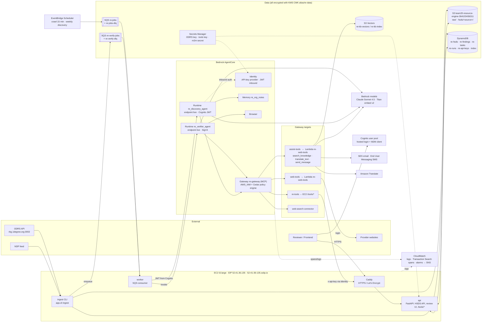
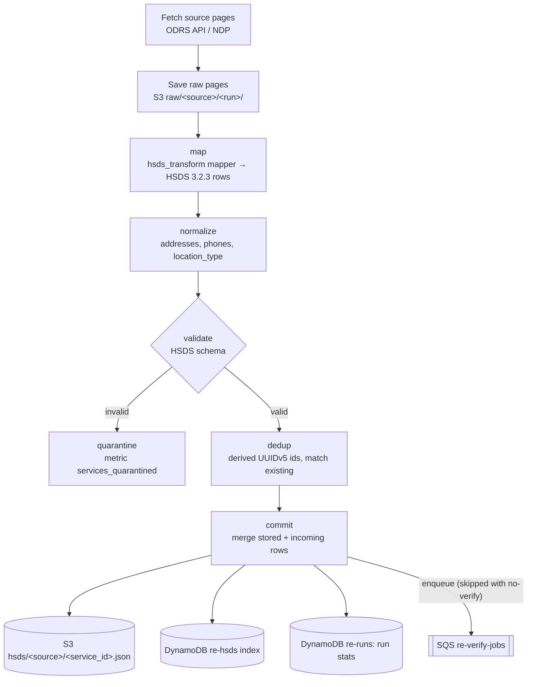
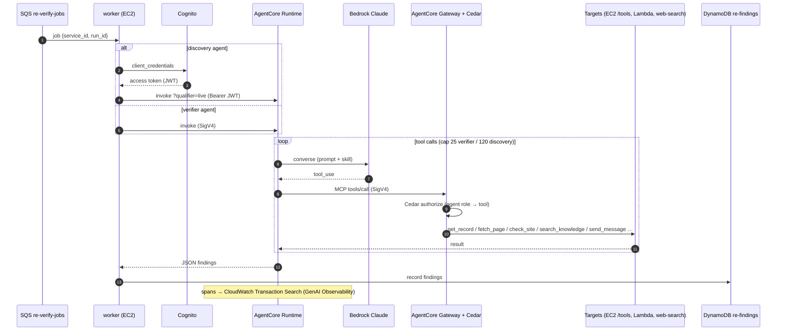

# Resource Engine: AWS architecture

Account `364103436311`, region `us-west-2`. Diagrams are Mermaid; they render on GitHub and in VS Code (Markdown Preview Mermaid).

## 1. AWS services map

## 2. Ingest pipeline (one source run)

## 3. Verification / discovery (one job)

## 4. Who owns what

| Layer | Tool |
|---|---|
| KMS, S3, DynamoDB, SQS, IAM roles | Terraform (`infra/terraform/`) |
| Cognito, Secrets, Lambda, AgentCore (Memory, Gateway, Identity, Runtimes), Scheduler, EC2, Observability, alarms | `infra/deploy.sh` (AWS CLI) |
| Shared outputs between the two | `infra/.state.json` |
