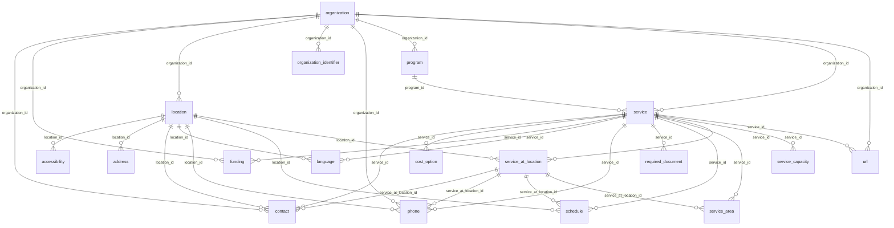

<!-- GENERATED by docs/hsds/tools/generate_reference.py from the vendored HSDS v3.2.3 schema. Do not edit by hand. -->

# HSDS v3.2.3 relationships

HSDS has two serializations of the same model (see [overview](README.md)):

- **JSON** (canonical): related objects are embedded. A `service` holds its `phones`, `schedules`, `service_at_locations` and so on. Foreign-key columns are optional there.
- **Tabular data package** (CSV): one file per object, linked by `*_id` foreign keys that hold the `id` (UUID) of the related row.

## Foreign keys (tabular form)

| Object | Column | Points to | Required |
|---|---|---|---|
| `accessibility` | `location_id` | `location.id` |  |
| `address` | `location_id` | `location.id` |  |
| `attribute` | `link_id` | any object; `link_entity` names its table | |
| `attribute` | `taxonomy_term_id` | `taxonomy_term.id` |  |
| `contact` | `organization_id` | `organization.id` |  |
| `contact` | `service_id` | `service.id` |  |
| `contact` | `service_at_location_id` | `service_at_location.id` |  |
| `contact` | `location_id` | `location.id` |  |
| `cost_option` | `service_id` | `service.id` |  |
| `funding` | `organization_id` | `organization.id` |  |
| `funding` | `service_id` | `service.id` |  |
| `language` | `service_id` | `service.id` |  |
| `language` | `location_id` | `location.id` |  |
| `language` | `phone_id` | `phone.id` |  |
| `location` | `organization_id` | `organization.id` |  |
| `metadata` | `resource_id` | any object, named by `resource_type` | |
| `organization` | `parent_organization_id` | `organization.id` |  |
| `organization_identifier` | `organization_id` | `organization.id` |  |
| `phone` | `location_id` | `location.id` |  |
| `phone` | `service_id` | `service.id` |  |
| `phone` | `organization_id` | `organization.id` |  |
| `phone` | `contact_id` | `contact.id` |  |
| `phone` | `service_at_location_id` | `service_at_location.id` |  |
| `program` | `organization_id` | `organization.id` |  |
| `required_document` | `service_id` | `service.id` |  |
| `schedule` | `service_id` | `service.id` |  |
| `schedule` | `location_id` | `location.id` |  |
| `schedule` | `service_at_location_id` | `service_at_location.id` |  |
| `service` | `organization_id` | `organization.id` |  |
| `service` | `program_id` | `program.id` |  |
| `service_area` | `service_id` | `service.id` |  |
| `service_area` | `service_at_location_id` | `service_at_location.id` |  |
| `service_at_location` | `service_id` | `service.id` |  |
| `service_at_location` | `location_id` | `location.id` |  |
| `service_capacity` | `service_id` | `service.id` |  |
| `service_capacity` | `unit_id` | `unit.id` |  |
| `taxonomy_term` | `parent_id` | `taxonomy_term.id` |  |
| `taxonomy_term` | `taxonomy_id` | `taxonomy.id` |  |
| `url` | `organization_id` | `organization.id` |  |
| `url` | `service_id` | `service.id` |  |

## Nested properties (JSON form)

`many` is a JSON array (1:many). `one` is a single embedded object (1:1).

| Object | Property | Embeds | Cardinality |
|---|---|---|---|
| `accessibility` | `attributes` | `attribute` | many |
| `accessibility` | `metadata` | `metadata` | many |
| `address` | `attributes` | `attribute` | many |
| `address` | `metadata` | `metadata` | many |
| `attribute` | `taxonomy_term` | `taxonomy_term` | one |
| `attribute` | `metadata` | `metadata` | many |
| `contact` | `phones` | `phone` | many |
| `contact` | `attributes` | `attribute` | many |
| `contact` | `metadata` | `metadata` | many |
| `cost_option` | `attributes` | `attribute` | many |
| `cost_option` | `metadata` | `metadata` | many |
| `funding` | `attributes` | `attribute` | many |
| `funding` | `metadata` | `metadata` | many |
| `language` | `attributes` | `attribute` | many |
| `language` | `metadata` | `metadata` | many |
| `location` | `languages` | `language` | many |
| `location` | `addresses` | `address` | many |
| `location` | `contacts` | `contact` | many |
| `location` | `accessibility` | `accessibility` | many |
| `location` | `phones` | `phone` | many |
| `location` | `schedules` | `schedule` | many |
| `location` | `attributes` | `attribute` | many |
| `location` | `metadata` | `metadata` | many |
| `meta_table_description` | `attributes` | `attribute` | many |
| `meta_table_description` | `metadata` | `metadata` | many |
| `organization` | `additional_websites` | `url` | many |
| `organization` | `funding` | `funding` | many |
| `organization` | `contacts` | `contact` | many |
| `organization` | `phones` | `phone` | many |
| `organization` | `locations` | `location` | many |
| `organization` | `programs` | `program` | many |
| `organization` | `organization_identifiers` | `organization_identifier` | many |
| `organization` | `attributes` | `attribute` | many |
| `organization` | `metadata` | `metadata` | many |
| `organization_identifier` | `attributes` | `attribute` | many |
| `organization_identifier` | `metadata` | `metadata` | many |
| `phone` | `languages` | `language` | many |
| `phone` | `attributes` | `attribute` | many |
| `phone` | `metadata` | `metadata` | many |
| `program` | `attributes` | `attribute` | many |
| `program` | `metadata` | `metadata` | many |
| `required_document` | `attributes` | `attribute` | many |
| `required_document` | `metadata` | `metadata` | many |
| `schedule` | `attributes` | `attribute` | many |
| `schedule` | `metadata` | `metadata` | many |
| `service` | `additional_urls` | `url` | many |
| `service` | `phones` | `phone` | many |
| `service` | `schedules` | `schedule` | many |
| `service` | `service_areas` | `service_area` | many |
| `service` | `service_at_locations` | `service_at_location` | many |
| `service` | `languages` | `language` | many |
| `service` | `organization` | `organization` | one |
| `service` | `funding` | `funding` | many |
| `service` | `cost_options` | `cost_option` | many |
| `service` | `program` | `program` | one |
| `service` | `required_documents` | `required_document` | many |
| `service` | `contacts` | `contact` | many |
| `service` | `capacities` | `service_capacity` | many |
| `service` | `attributes` | `attribute` | many |
| `service` | `metadata` | `metadata` | many |
| `service_area` | `attributes` | `attribute` | many |
| `service_area` | `metadata` | `metadata` | many |
| `service_at_location` | `service_areas` | `service_area` | many |
| `service_at_location` | `contacts` | `contact` | many |
| `service_at_location` | `phones` | `phone` | many |
| `service_at_location` | `schedules` | `schedule` | many |
| `service_at_location` | `location` | `location` | one |
| `service_at_location` | `attributes` | `attribute` | many |
| `service_at_location` | `metadata` | `metadata` | many |
| `service_capacity` | `unit` | `unit` | one |
| `service_capacity` | `attributes` | `attribute` | many |
| `service_capacity` | `metadata` | `metadata` | many |
| `taxonomy` | `metadata` | `metadata` | many |
| `taxonomy_term` | `taxonomy_detail` | `taxonomy` | one |
| `taxonomy_term` | `metadata` | `metadata` | many |
| `unit` | `attributes` | `attribute` | many |
| `unit` | `metadata` | `metadata` | many |
| `url` | `attributes` | `attribute` | many |
| `url` | `metadata` | `metadata` | many |

## Diagram (core objects and their direct children)

